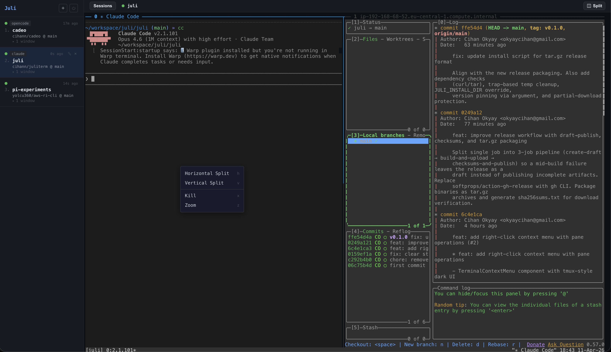
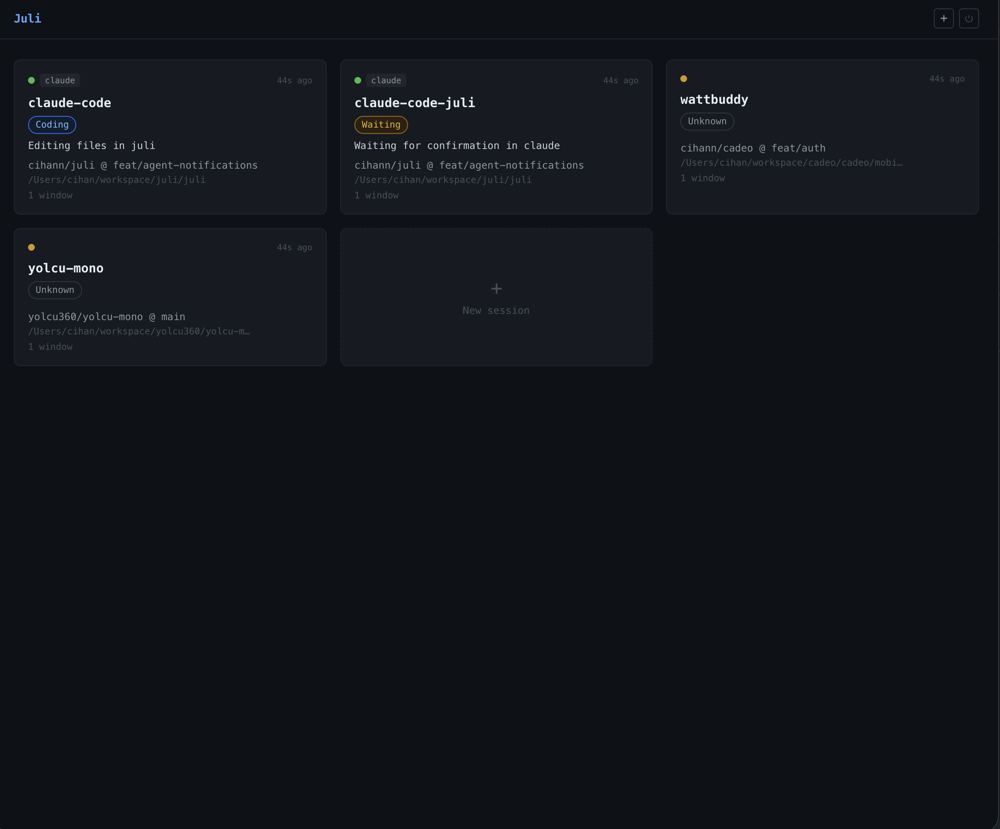

# Juli

[](https://github.com/cihann/juliterm/actions/workflows/ci.yml)
[](https://go.dev)
[](LICENSE)

Juli is a web-based tmux client. It runs a small Go server on your machine and lets you access your tmux sessions from any browser — on your phone, tablet, or another computer. Each browser tab connects to a real PTY running `tmux attach-session`, so it behaves exactly like a native terminal.

One binary. No dependencies besides tmux; `cloudflared` is optional and only needed for `--tunnel`.





## Install

```bash
curl -fsSL https://raw.githubusercontent.com/cihann/juliterm/main/install.sh | sh
```

Or download a binary manually from the [releases page](https://github.com/cihann/juliterm/releases).

### Build from source

```bash
make build    # outputs ./juli
```

Requires Go 1.25+ and Node.js 20+ (for the frontend build step).

## Usage

```bash
juli --token SECRET
```

Open `http://localhost:8080` in your browser, enter the token, and you'll see your tmux sessions.

### Flags

| Flag | Default | Description |
|------|---------|-------------|
| `--token` | (required) | Authentication token. Also reads `JULI_TOKEN` env var. |
| `--port` | `8080` | HTTP server port. |
| `--config` | `~/.config/juli/config.yaml` | Path to config file. |
| `--tunnel` | `false` | Expose via Cloudflare Quick Tunnel. Prints a public URL and QR code. |
| `--tls-cert` | | Path to TLS certificate file. |
| `--tls-key` | | Path to TLS private key file. |
| `--tmux-path` | `tmux` | Path to tmux binary. |

### Environment variables

| Variable | Description |
|----------|-------------|
| `JULI_TOKEN` | Alternative to `--token` flag. |

## Features

- **Session tree** — Browse sessions, windows, and panes from the sidebar.
- **Split panes** — Split your terminal and run lazygit, test runners, or any command from the toolbar dropdown. Splits are powered by tmux itself; Juli just orchestrates the commands.
- **Mobile friendly** — Compact layout with pane zoom for small screens.
- **Tunnel access** — `--tunnel` creates a Cloudflare Quick Tunnel and prints a QR code for instant mobile access.
- **Custom split presets** — Define your own frequently-used splits in the config file (see below).
- **Auto-detect test runner** — Juli looks for `go.mod`, `package.json`, `Cargo.toml`, or a Makefile `test` target and picks the right test command.
- **TLS support** — Pass `--tls-cert` and `--tls-key` for HTTPS.
- **Single binary** — The Nuxt frontend is embedded into the Go binary at build time. No separate web server needed.

## Right-click pane menu

Right-click inside the terminal to open Juli's pane menu:

```
  Horizontal Split   h
  Vertical Split     v
  ───────────────────
  Kill               x
  Zoom               z
```

Juli intercepts the right-click and shows its own context menu instead of forwarding the event to tmux. This is intentional — tmux has a built-in right-click menu when mouse mode is enabled (`set -g mouse on`), but it only works with mouse mode on, renders as text inside the terminal, and cannot be styled or extended. Juli's menu works regardless of tmux's mouse mode setting, stays visually consistent with the rest of the UI, and can be extended with Juli-specific actions in the future.

## Split pane toolbar

Click the **Split** button in the toolbar to open a dropdown with quick-access split commands.

```
lazygit
Run Tests — npm test
─────────────────────
run test              <- project preset
docker compose up     <- project preset
─────────────────────
Custom…
```

- **lazygit** — Opens lazygit in a new pane.
- **Run Tests** — Auto-detects your test runner (`go test`, `npm test`, `cargo test`, etc.) and runs it in a split pane.
- **Project/global presets** — Your own presets from `~/.config/juli/config.yaml` or `.juli.yaml` appear in the middle (see [Custom split presets](#custom-split-presets)).
- **Custom...** — Type any command to run in a new pane.

## Remote access

The `--tunnel` flag creates a [Cloudflare Quick Tunnel](https://developers.cloudflare.com/cloudflare-one/connections/connect-networks/do-more-with-tunnels/trycloudflare/) — a temporary public URL that forwards traffic to your local Juli server. No Cloudflare account required.

```bash
juli --token SECRET --tunnel
```

Juli prints the tunnel URL and a QR code to the terminal:

```
Tunnel: https://random-words.trycloudflare.com
WARNING: Juli is now accessible from the internet. Ensure your --token is a strong, unique secret.
█████████████████████████████
█████████████████████████████
...
```

Point your phone camera at the QR code, open the link, enter the token, and you're in.

### Requirements

[cloudflared](https://github.com/cloudflare/cloudflared) must be installed and in your `PATH`:

```bash
# macOS
brew install cloudflared

# Debian/Ubuntu
apt install cloudflared
```

### How it works

`cloudflared tunnel --url http://localhost:<port>` runs as a child process. Juli parses the generated URL from its output, prints it with a QR code, and stops the tunnel on exit. If cloudflared is not installed or the tunnel fails to start, Juli logs a warning and continues serving locally.

### Tunnel security

- The tunnel URL is **temporary** and changes every time Juli restarts.
- Anyone with the URL still needs the `--token` to authenticate.
- See the [Security](#security) section below for general guidance.

## Configuration

Juli reads its config from `~/.config/juli/config.yaml`. If the file doesn't exist, Juli starts with defaults — no config file is required.

You can override the config path with `--config`:

```bash
juli --token SECRET --config /path/to/my-config.yaml
```

### Custom split presets

The built-in Split dropdown comes with **lazygit** and **Run Tests**. You can add your own presets in two places:

**Global presets** go in `~/.config/juli/config.yaml` and appear in every session:

```yaml
# ~/.config/juli/config.yaml
splits:
  - name: htop
    command: htop
    direction: horizontal
    percent: 30

  - name: k9s
    command: k9s
    direction: vertical
    percent: 50
```

**Project presets** go in a `.juli.yaml` file at your project root and only appear when a session's working directory is inside that project:

```yaml
# /path/to/my-project/.juli.yaml
splits:
  - name: dev server
    command: npm run dev
    direction: vertical
    percent: 25
    detach: true

  - name: storybook
    command: npm run storybook
    direction: horizontal
    percent: 50
```

This file can be committed to your repo so your team shares the same presets.

Juli finds `.juli.yaml` by walking up from the active pane's current directory. If a project preset has the same name as a global one, the project version takes priority.

Each preset has the following fields:

| Field | Required | Default | Description |
|-------|----------|---------|-------------|
| `name` | yes | | Display label in the dropdown and the identifier used internally. |
| `command` | yes | | Shell command to run in the new pane. |
| `direction` | no | `horizontal` | `horizontal` splits right, `vertical` splits down. |
| `percent` | no | `50` | Size of the new pane (1-90). |
| `detach` | no | `false` | If `true`, focus stays on the original pane. Useful for background tasks like log tailing or dev servers. |

The dropdown groups presets by source:

```
lazygit            <- built-in
Run Tests          <- built-in
---
htop               <- global config
k9s                <- global config
---
dev server         <- .juli.yaml (project)
storybook          <- .juli.yaml (project)
---
Custom...          <- free-form input
```

Built-in presets always appear first. The **Custom...** option always appears last. Empty groups are hidden.

## Development

### Running tests

```bash
go test ./...           # backend
cd web && npm test      # frontend (Vitest)
```

### Cross-compiling releases

```bash
make release
```

Produces binaries for linux/amd64, linux/arm64, darwin/amd64, and darwin/arm64 in the `release/` directory.

## How it works

Juli connects your browser to tmux through a lightweight bridge:

1. Browser opens a WebSocket to `/ws` with a session cookie.
2. Server sends the full session tree (sessions, windows, panes) as a binary message.
3. User selects a session. Server spawns a PTY running `tmux attach-session -t <name>`.
4. Raw bytes flow between the PTY and the WebSocket. xterm.js renders them in the browser.
5. When tmux state changes (new window, closed pane), the server broadcasts an updated session tree to all clients.

Split panes are "fire and forget" — Juli sends `tmux split-window` and `send-keys` commands, then tmux renders the splits natively inside the existing PTY. No new WebSocket connections or xterm.js instances are created.

## Security

**Juli gives every authenticated user full shell access.** This is by design — it is a terminal client. Anyone who can log in can run arbitrary commands with the privileges of the Juli process, whether by typing into the terminal, using the split-pane custom command feature, or calling the API directly.

This means:

- **Treat the token like a root password.** Use a strong, unique value. Do not share it with anyone you wouldn't give SSH access to.
- **Do not expose Juli to the public internet without TLS.** The token is sent in plain text over HTTP. Use `--tls-cert`/`--tls-key`, a reverse proxy, or the `--tunnel` flag (which provides TLS via Cloudflare).
- **Juli is single-user by design.** There are no roles, permissions, or audit logs. If you need multi-user access control, put Juli behind an authenticating reverse proxy.

## License

MIT
